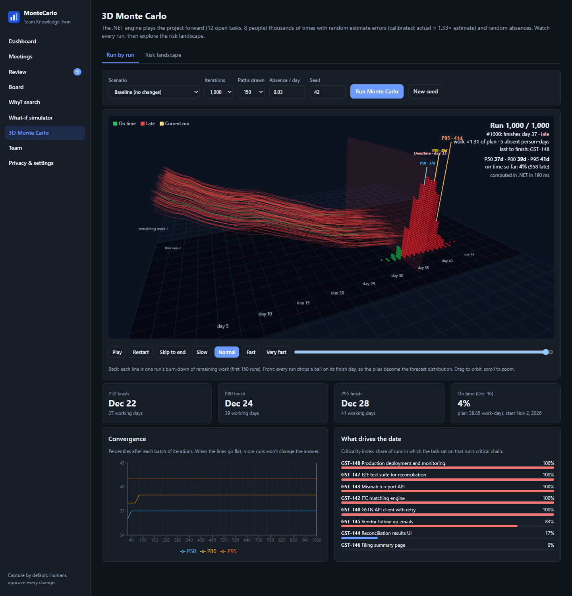

# MonteCarlo – Team Knowledge Twin

Captures decisions, action items and blockers from meetings, reconciles them against tickets and code,
lets a human approve every change, and forecasts delivery with a Monte Carlo what-if simulator and 3D views.



**New to this? Start with the [wiki](../../wiki)**: plain-language guides with screenshots (getting started, a tour of every screen, how the forecast works, how to read the 3D view).

```
MCSimulator/
├─ MonteCarlo.Backend/   .NET 10 clean architecture (SQL Server LocalDB)
│  └─ src/
│     ├─ MonteCarlo.Domain          entities, reconciliation rules, simulation engine (references nothing)
│     ├─ MonteCarlo.Application     use cases + ports (ITicketSystem, ILlmExtractor, ITranscriptSource, ...)
│     ├─ MonteCarlo.Infrastructure  EF Core + migrations, extractors, Jira / GitHub / Microsoft Graph adapters
│     └─ MonteCarlo.Api             minimal API, webhooks, background workers (composition root)
└─ MonteCarlo.UI/        React + Vite + Three.js (react-three-fiber)
```

## Run

Requirements: .NET 10 SDK, Node 20+, SQL Server LocalDB (`sqllocaldb info` should list `MSSQLLocalDB`).

```powershell
.\start.ps1
```

or by hand:

```powershell
cd MonteCarlo.Backend; dotnet run --project src/MonteCarlo.Api      # http://localhost:5080  (Swagger: /swagger)
cd MonteCarlo.UI;      npm install; npm run dev                      # http://localhost:5173
```

On startup the API **applies EF Core migrations automatically** (creates database `MonteCarloTwin` on LocalDB),
then seeds a demo project (GST reconciliation team) and extracts a sample sprint call.
Set `"SeedDemoData": false` in `appsettings.json` to start empty.

Reset the database: `cd MonteCarlo.Backend; dotnet ef database drop -f --project src/MonteCarlo.Infrastructure --startup-project src/MonteCarlo.Api`

Add a migration after changing entities:
`dotnet ef migrations add <Name> --project src/MonteCarlo.Infrastructure --startup-project src/MonteCarlo.Api --output-dir Persistence/Migrations`

## What's in the UI

| Page | What it does |
|---|---|
| Dashboard | ticket freshness, suggestion precision, stale tickets, blockers, decisions, quality scores, weekly digest |
| Meetings | paste/upload a transcript (Teams `.vtt` or `[hh:mm:ss] Name: text`); see extracted items linked to the exact moment |
| Review | Adaptive-Card style suggestions: accept, edit or reject. Accepted changes are written to the ticket system |
| Board | kanban with quality badges, ticket editor with "why it looks like this" evidence timeline, code events |
| Why? search | search decisions/actions/blockers/transcripts; the answer cites its source |
| What-if simulator | Monte Carlo (common random numbers, history-calibrated), scenarios, P50/P80/P95, 3D city replay |
| 3D Monte Carlo | every simulated run drawn in 3D (burn-down paths, finish-day piles, P50/P80/P95 poles, convergence, criticality) plus a risk-landscape surface over two levers (capacity, scope, hires, absence). All numbers are computed in .NET (`MonteCarloEngine.Explore`, `SimulationService.LandscapeAsync`) |
| Team | people, roles, capacity, start/leave dates |
| Privacy & settings | retention, opt-out default, data region, stale threshold, audit log |

## Integrations (all optional, in `MonteCarlo.Api/appsettings.json`)

- **Llm** – `Provider`: `RuleBased` (default, offline), `OpenAI` (any OpenAI-compatible endpoint) or `AzureOpenAI`, plus `ApiKey`, `Model`/`AzureDeployment`. Extraction uses a strict JSON schema and falls back to rules on failure.
- **Jira** – `BaseUrl`, `Email`, `ApiToken`. When set, tickets sync from Jira and accepted suggestions are written back. Otherwise the built-in local board is used.
- **GitHub** – `Owner`, `Repo`, `Token` to pull commits/PRs hourly. Or point a GitHub webhook at `POST /api/webhooks/github`.
- **Graph** – `TenantId`, `ClientId`, `ClientSecret`, `UserId`, `NotificationUrl` (public HTTPS URL of `/api/webhooks/graph`). Needs `OnlineMeetingTranscript.Read.All` (or RSC). The subscription is created and renewed by the maintenance worker.
