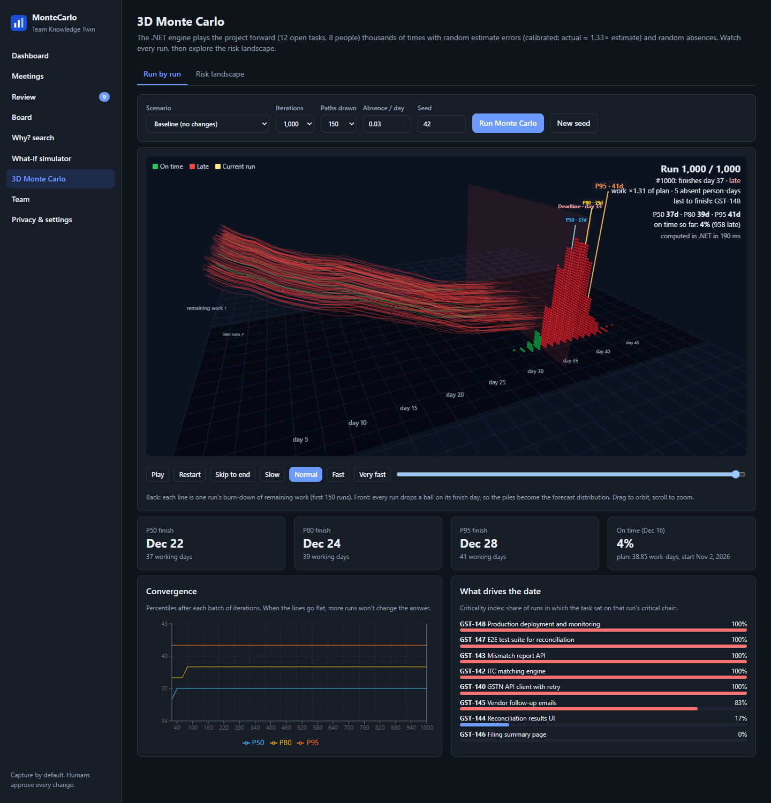
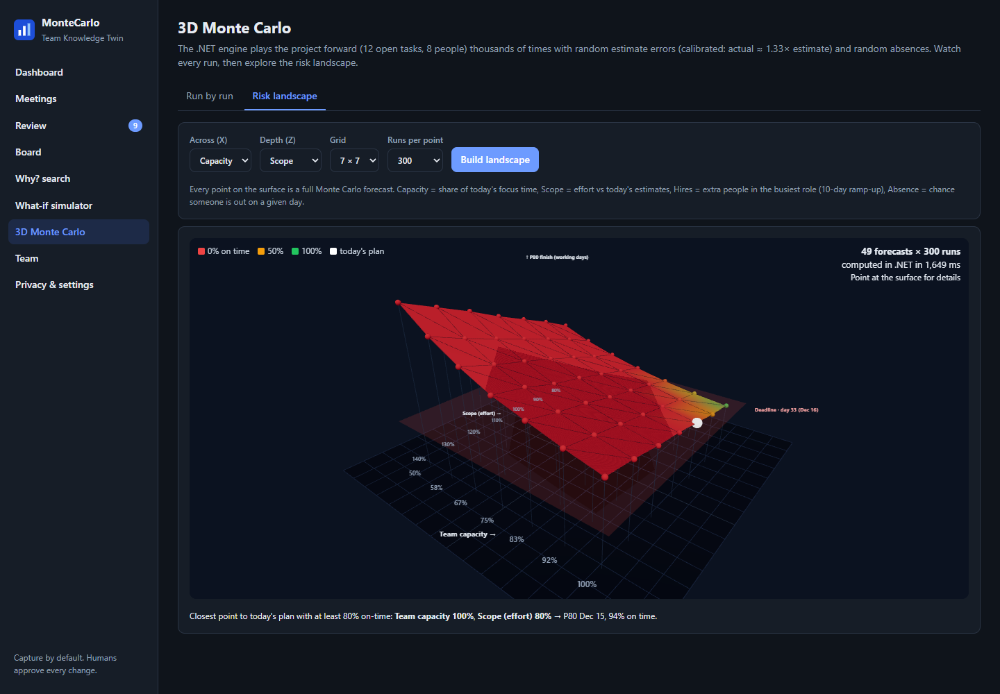

# Reading the 3D Monte Carlo View

Open **3D Monte Carlo** in the left menu. It has two tabs. Both show real numbers calculated by the .NET backend; the browser only draws them.

---

## Tab 1: Run by run

This shows the simulation happening, one run after another.

### What you are looking at

| In the 3D scene | What it means |
|---|---|
| **Thin lines running left to right (the back)** | One line = one simulated run. It shows the *remaining work* shrinking day by day. Lines that stay high for longer are unlucky runs. The first 150 runs are drawn (you can change this). |
| **The bright yellow line and glowing dot** | The run being played right now. |
| **Balls piling up at the front** | When a run finishes, a ball drops onto the day it finished. Balls pile up into a hill: **the tall part of the hill is the most likely finish day**. |
| **Ball colours** | **Green** = finished on time. **Red** = finished after the deadline. **Purple** = never finished. |
| **The big translucent red wall** | The **deadline**. Everything on or left of the wall is on time. |
| **Three coloured poles (P50, P80, P95)** | The percentile dates. They **slide around as more runs finish** and settle once the forecast is stable. |
| **"day 5, day 10…" labels** | Working days from today. |

### The controls

- **Scenario**: baseline, or a what-if such as *Two backend developers leave*, *Client scope +20%*, *Hire a backend contractor* or *15% more meetings*.
- **Iterations**: how many runs to simulate (200 to 5,000).
- **Paths drawn**: how many of those runs get a line (more lines look busier but cost more to draw).
- **Absence / day**: chance that someone is out on a given day.
- **Seed / New seed**: the starting point of the randomness. See [How the Forecast Works](How-the-Forecast-Works).
- **Play, Pause, Restart, Skip to end**, the **speed buttons** and the **slider**: scrub through the runs like a video. Drag the 3D view to orbit and scroll to zoom.

### The numbers in the top-right corner

- *Run 458 / 1,000*: how far along you are.
- *"#458: finishes day 37, late"*: what that particular run did, how much extra work the dice gave it (*work ×1.31 of plan*) and how many person-days of absence it hit.
- *"P50 37d, P80 39d, P95 41d, on time so far 4%"*: the forecast **as it stood after that many runs**.

### Below the 3D view

- **Four headline cards**: P50, P80, P95 and the chance of hitting the deadline.
- **Convergence chart**: how P50, P80 and P95 changed as runs were added. When the lines go flat, you have run enough simulations.
- **What drives the date** (the *criticality index*): for every run, the app finds the chain of tasks that decided the finish day. A task at 100% decided the date in *every* run, so any slip there slips the project. A task at 0% has plenty of slack.

---

## Tab 2: Risk landscape

Instead of asking *"what if just this one thing changes?"*, this asks **"what if these two things change by different amounts?"** for 49 combinations at once. Each point on the surface is a complete Monte Carlo forecast.

### How to read it

| In the 3D scene | What it means |
|---|---|
| **Height** of the surface | **P80 finish day**. Higher means later. |
| **Colour** | **Chance of making the deadline**: red 0%, amber 50%, green 100%. |
| **The flat translucent red plane** | The deadline. Parts of the surface **below** the plane finish on time. |
| **The white ball** | *Today's plan*, i.e. things as they are now. |
| **Hover over any dot** | Details: P50, P80, P95, on-time chance, and how many days better or worse than today's plan. |

### Choose your two levers

| Lever | Plain meaning |
|---|---|
| **Capacity** | How much of everyone's day goes to project work (50% to 100% of today). |
| **Scope** | How much work there is, compared with today's estimates (80% to 140%). |
| **Hires** | Extra people added in the busiest role (each needs 10 days to ramp up). |
| **Absence** | Chance that someone is out on any day (0% to 24%). |

You can also change the grid size (5×5, 7×7, 9×9) and the number of runs per point.

Under the picture, the app points out **the closest combination to today's plan that gives at least an 80% chance of finishing on time**, for example *"Capacity 100%, Scope 80%"*. That is a concrete "what would we have to change?" answer.

> **Tip:** with the demo data, the surface is mostly red because the demo deadline is very tight. That is the app doing its job, which is to show you the problem before it happens.

---

## Where the real work happens

The simulation is **plain C# in the backend** (not in the browser):

| Picture | Code |
|---|---|
| Run by run | `MonteCarloEngine.Explore` in `MonteCarlo.Domain/Simulation/` |
| Risk landscape | `SimulationService.LandscapeAsync` in `MonteCarlo.Application/Services/` |

See [For Developers](For-Developers) for details.
