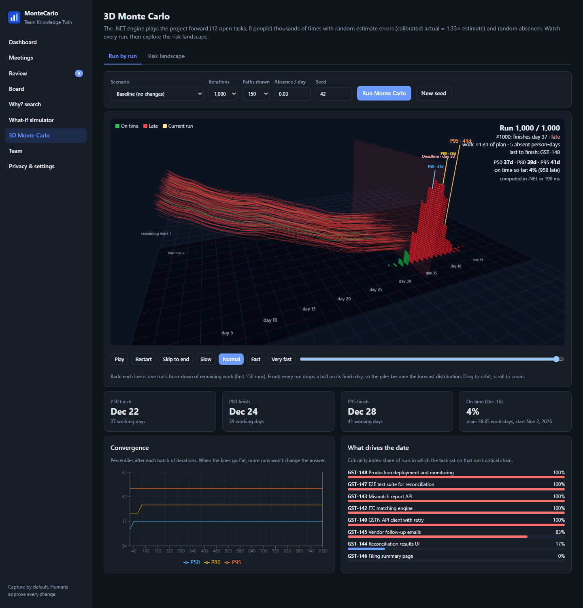

# MonteCarlo: Team Knowledge Twin

> **A teammate that sits in every meeting, remembers every decision, keeps your task board honest, and tells you straight when the project will really finish.**

## The problem, in plain words

Every team has the same four headaches:

- **Promises vanish.** Someone says *"I'll fix the timeout by Friday"* in a meeting. Nobody writes a ticket. Friday comes and goes.
- **The task board lies.** A ticket says *In Progress* for three weeks. The work was actually finished (or dropped) long ago.
- **Nobody remembers why.** Six months later someone asks *"Why did we drop Excel export?"* and no one can find the answer.
- **Deadlines are guesses.** *"It'll be done by the 16th"* is really a hopeful number, not a forecast.

## What this app does about it

| Step | What happens | Plain-words version |
|---|---|---|
| **1. Listen** | You drop in a meeting transcript. | It reads the conversation and pulls out **decisions**, **to-dos** and **blockers**, each with the exact quote and the moment it was said. |
| **2. Compare** | It checks those against your task board and code activity. | *"Arjun said he'd take the mismatch report, but the ticket has no owner."* |
| **3. Ask you** | It shows a short list of suggested fixes. | You tap **Accept**, **Edit** or **Reject**. **Nothing changes until a human says yes.** |
| **4. Predict** | A Monte Carlo simulator plays your project forward thousands of times. | *"There is an 80% chance we finish by 24 Dec, and only a 4% chance of hitting 16 Dec."* |

Then you can ask **"what if?"** (what if two developers leave, scope grows 20%, we hire a contractor?) and watch the answer in **3D**.

## Start here

- [Getting Started](Getting-Started): run it on your computer in a couple of minutes
- [A Tour of the App](Tour-of-the-App): every screen, with pictures
- [How the Forecast Works](How-the-Forecast-Works): the Monte Carlo idea, no maths required
- [Reading the 3D Monte Carlo View](3D-Monte-Carlo-Guide): what the lines, balls and surface mean
- [Connecting Your Tools](Connecting-Your-Tools): Jira, GitHub, Microsoft Teams and AI (all optional)
- [Glossary and FAQ](Glossary-and-FAQ): P50, P80, critical path and other words, plus common questions
- [For Developers](For-Developers): how the code is organised

## Good to know

- It works **fully offline** out of the box, with demo data included. No accounts, no API keys.
- **Humans stay in charge.** The app suggests; people approve.
- Data lives in a **local database** on your machine (SQL Server LocalDB).
