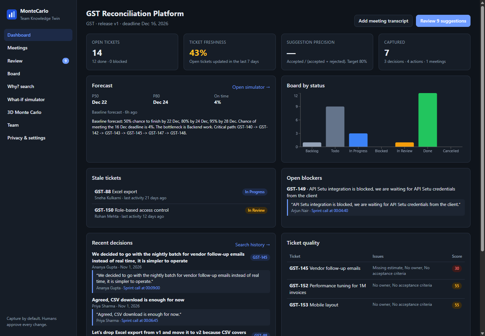
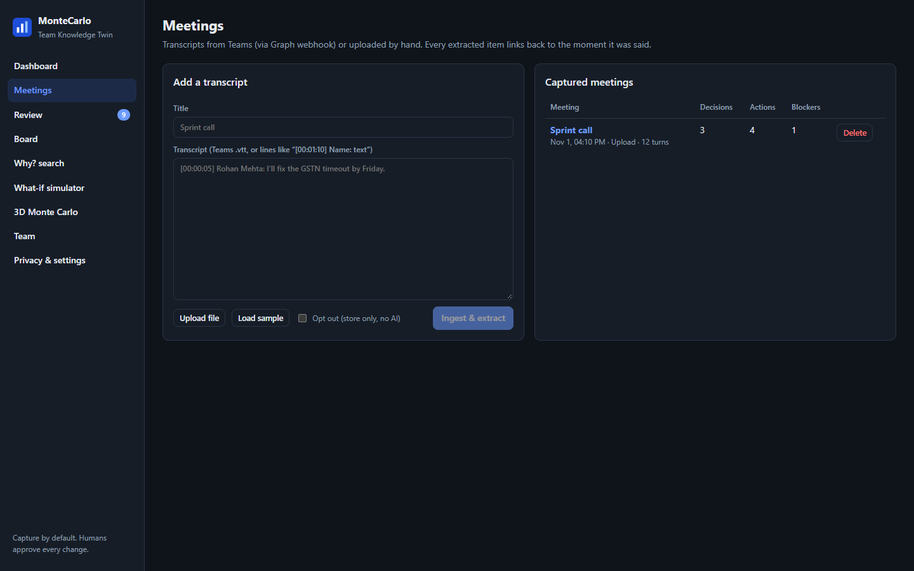
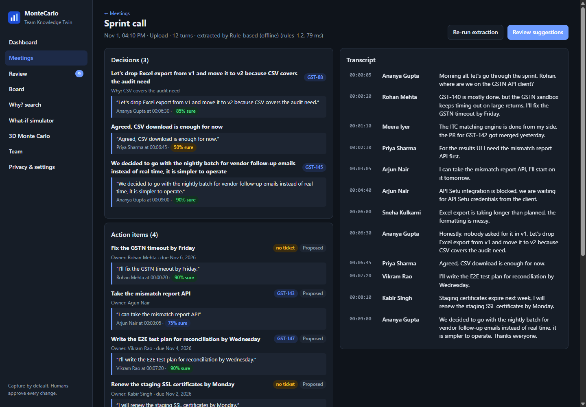
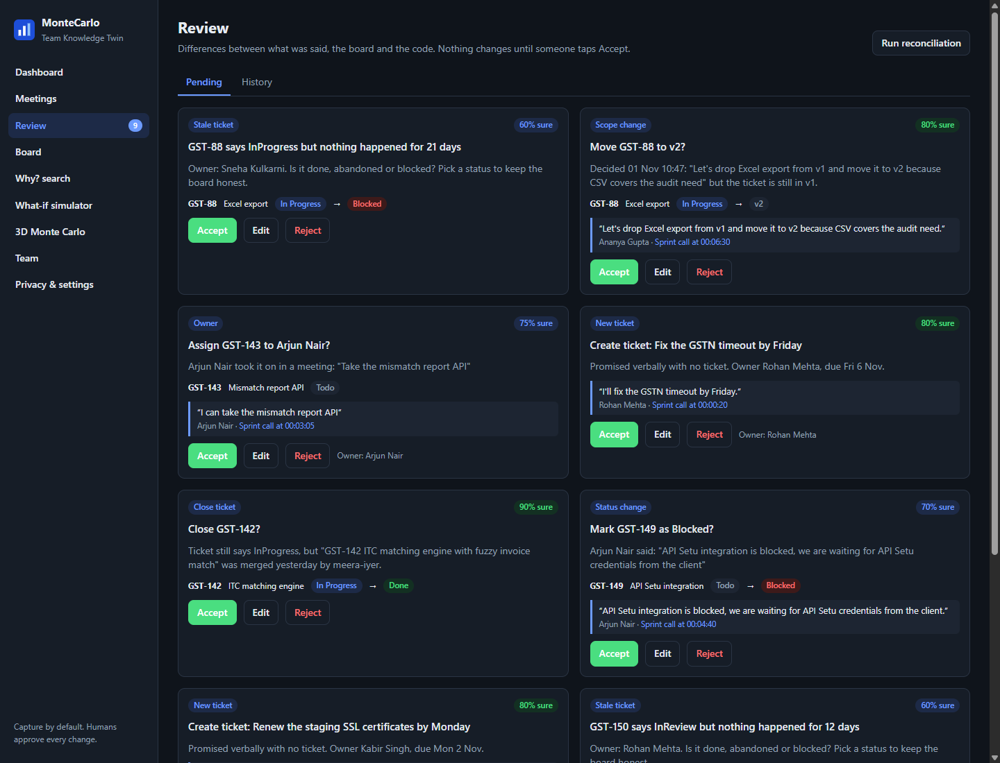
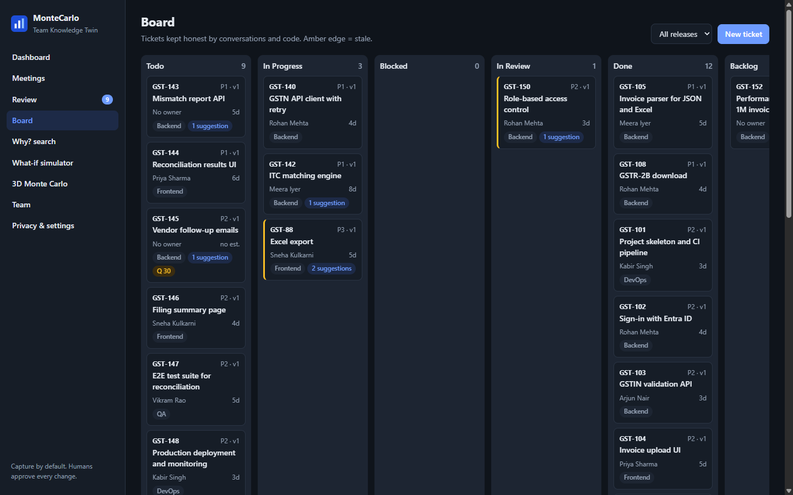
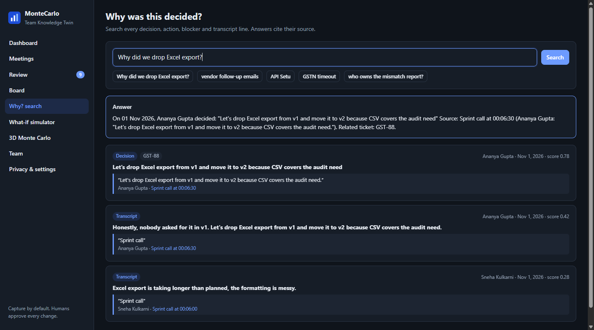
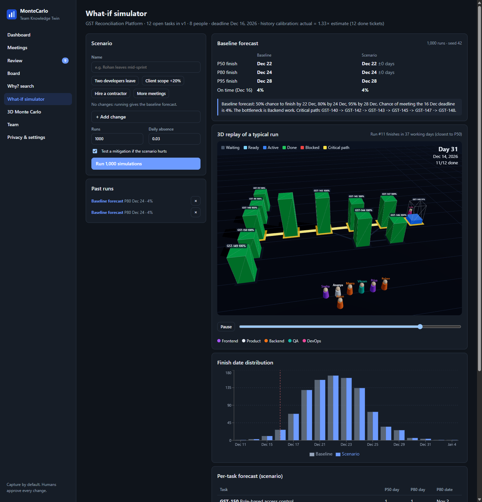
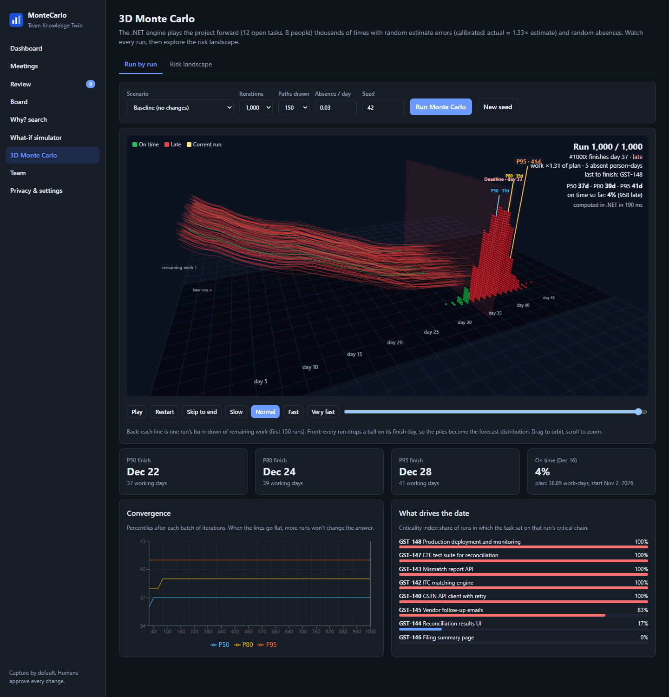
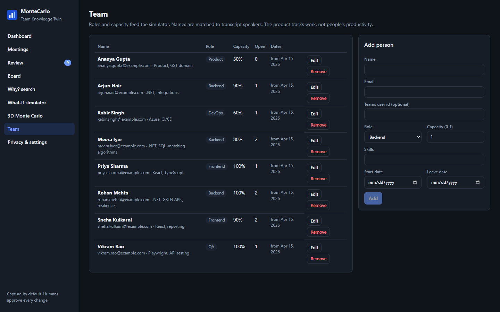
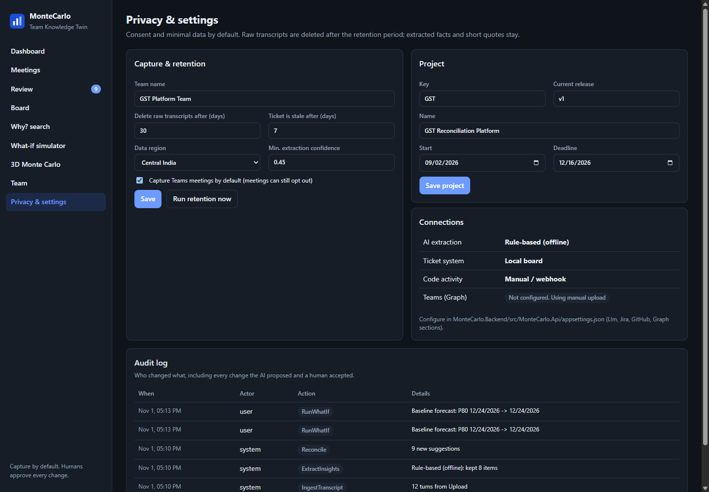

# A Tour of the App

Everything below uses the built-in demo team (a fictional "GST Reconciliation Platform" project with 8 people), so you can click through it yourself right after [starting the app](Getting-Started).

The left-hand menu is your map. The little blue number next to **Review** is how many suggestions are waiting for you.

---

## 1. Dashboard: "How are we doing?"

A one-screen health check of the project.

- **Open tickets** and **Ticket freshness**: how many tickets are still open, and what share were touched in the last 7 days. Low freshness means the board is going stale.
- **Suggestion precision**: once people start accepting and rejecting suggestions, this shows how often the app was right. The target is 80%.
- **Forecast**: the latest finish-date prediction in plain English.
- **Stale tickets**, **Open blockers**, **Recent decisions** and **Ticket quality**: the things most likely to need attention this week.

---

## 2. Meetings: "What was said?"

Paste a transcript (or upload a Microsoft Teams `.vtt` file), or click **Load sample**, then press **Ingest & extract**.

Tick **Opt out** if a meeting is sensitive: it is stored but never analysed.

### Inside a meeting

The app pulls out three kinds of things:

| It finds | Example from the demo |
|---|---|
| **Decisions** | *"Let's drop Excel export from v1 and move it to v2 because CSV covers the audit need."* |
| **Action items** | *"I'll fix the GSTN timeout by Friday."* (owner and due date picked up too) |
| **Blockers** | *"API Setu integration is blocked, we are waiting for credentials from the client."* |

Every item shows the **exact quote**, **who said it**, **when** (click the timestamp to jump to that moment in the transcript) and a **confidence score** (*85% sure*).

---

## 3. Review: "Is this right?"

This is where the app earns trust. It compares what was said with your task board and code activity, then **proposes** changes:

| Suggestion | What it means |
|---|---|
| **New ticket** | Someone promised something out loud, but no ticket exists. |
| **Close ticket** | A pull request was merged, but the ticket still says *In Progress*. |
| **Scope change** | The team decided to drop or postpone something. |
| **Owner** | Someone said *"I'll take it"*, but the ticket has no owner. |
| **Status change** | A blocker was mentioned, so the ticket should show *Blocked*. |
| **Stale ticket** | Nothing has happened for a long time. Is it done, abandoned or blocked? |

For each card you choose **Accept**, **Edit** (tweak it first) or **Reject**. **Nothing changes until you do.** Every decision is written to the audit log.

---

## 4. Board: "What is everyone working on?"

A classic task board with columns from *Todo* to *Done*. Extras:

- A blue **"1 suggestion"** tag shows tickets that have a fix waiting in Review.
- An **amber edge** means the ticket is stale.
- A **quality badge** (like *Q 30*) flags tickets with no owner, no estimate or no acceptance criteria.
- Open any ticket to see a **timeline of why it looks the way it does**: the meeting quote, the code event, the decision.

---

## 5. Why? search: "Why did we decide that?"

Ask a normal question. You get a short **answer** and, underneath, the **evidence** with a link back to the exact moment in the meeting. No more digging through old recordings.

---

## 6. What-if simulator: "When will we finish, and what if…?"

Pick a ready-made scenario (*Two developers leave*, *Client scope +20%*, *Hire a contractor*, *More meetings*) or build your own, then press **Run 1,000 simulations**. You get:

- Finish dates at **P50 / P80 / P95** (see [How the Forecast Works](How-the-Forecast-Works)), and the **chance of making the deadline**.
- A plain-English **summary** that names the bottleneck.
- A **3D city replay** of one typical run: each task is a building that rises as work completes, people walk between them, blocked work glows red, and the lit yellow road is the critical path.
- A **histogram** comparing baseline and scenario, with the deadline marked.
- If your scenario makes things worse, it automatically **tests a fix** (such as hiring a contractor) and tells you how many days that recovers.

---

## 7. 3D Monte Carlo: "Show me the maths, visually"

Watch **every single simulated run** being drawn, then explore a **risk landscape**. Full explanation: [Reading the 3D Monte Carlo View](3D-Monte-Carlo-Guide).

---

## 8. Team: "Who can do the work?"

The people, their roles, how much of their day is available for project work (**capacity**), and start or leave dates. The simulator uses all of this. Names are also matched to speakers in transcripts.

> The app tracks **work**, not people's productivity.

---

## 9. Privacy & settings: "Who sees what, and for how long?"

- Delete raw transcripts after N days (the extracted facts and short quotes stay).
- Choose when a ticket counts as stale and how confident the extractor must be.
- See which optional connections are switched on.
- Read the **audit log**: who changed what, including every change the app proposed and a human accepted.
